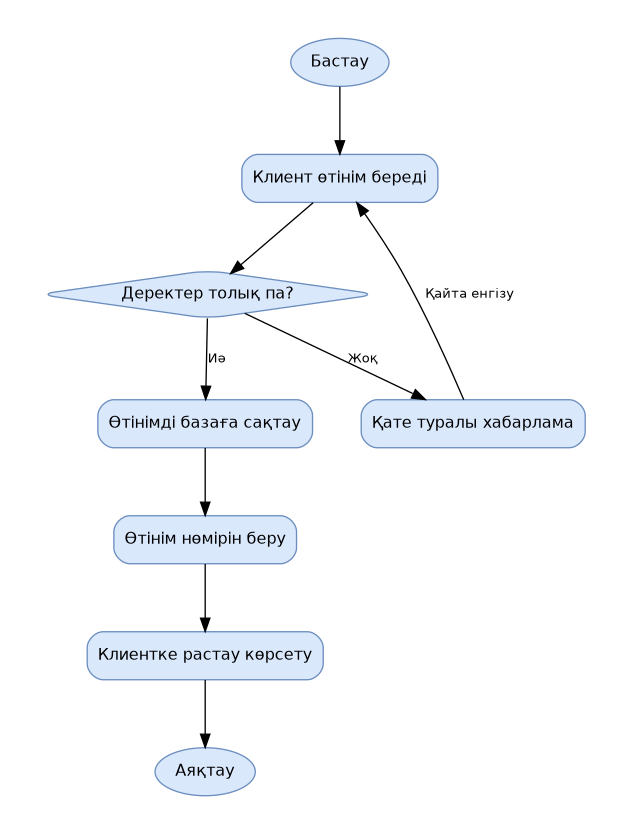
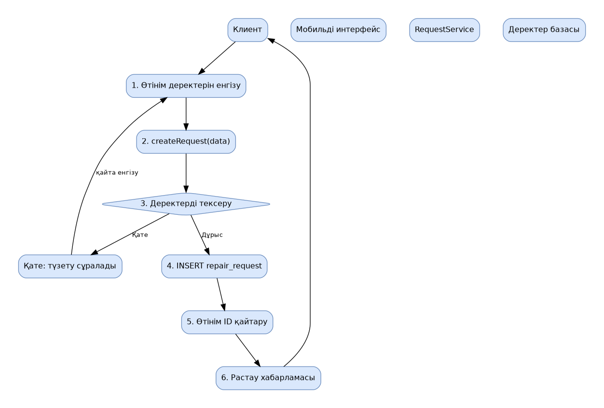

# Компьютерлерді жөндеу орталығының ақпараттық жүйесі

**Дипломдық жоба:** Нұрмахамбет Әли.

## Жобаның мақсаты
Компьютерлерді жөндеу орталығына түсетін өтінімдерді тіркеуді, жөндеу мәртебесін бақылауды және клиенттермен жұмысты автоматтандыру.

## Негізгі мүмкіндіктер
- Клиенттің жөндеуге өтінім беруі;
- Құрылғы түрі мен ақау сипаттамасын енгізу;
- Өтінім нөмірін қалыптастыру;
- Жөндеу мәртебесін қарау;
- Қызметкерге өтінімдерді өңдеу мүмкіндігі.

## Диаграммалар
**Сценарий:** клиент жаңа жөндеу өтінімін тіркейді.

### Activity Diagram

[Өңделетін .drawio файлы](docs/analysis/activity-create-repair-request.drawio)

### Sequence Diagram

[Өңделетін .drawio файлы](docs/analysis/sequence-create-repair-request.drawio)

## Жүйе компоненттері
Клиент → интерфейс → RequestService → деректер базасы. Қате деректер енгізілсе, жүйе түзетуді сұрайды; дұрыс болса, өтінімді сақтап, нөмірін қайтарады.

> Бұл репозиторийде жүйенің талаптары мен UML жобалық диаграммалары берілген; толық іске асырылған мобильді қосымша емес.
